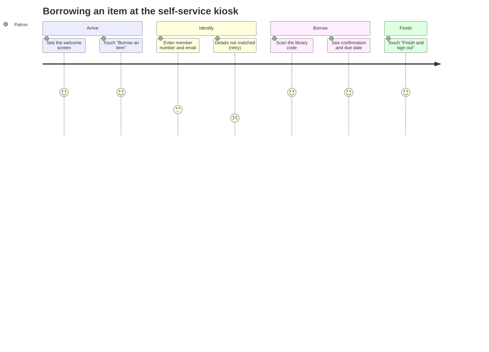
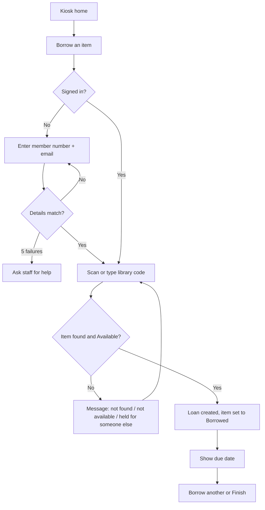
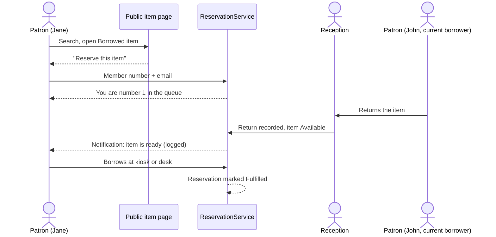
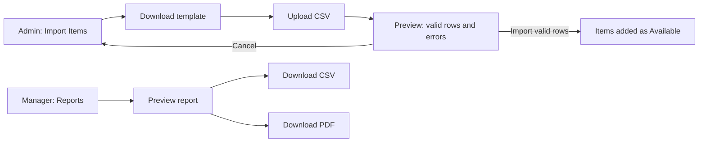

# User Journey Maps (Person 3 features)

Mermaid diagrams: paste into any Mermaid renderer (or GitHub) to export images for the portfolio.

## Journey 1: Patron borrows at the kiosk

## Journey 2: Reservation and waitlist

## Journey 3: Admin imports items / Manager exports reports

